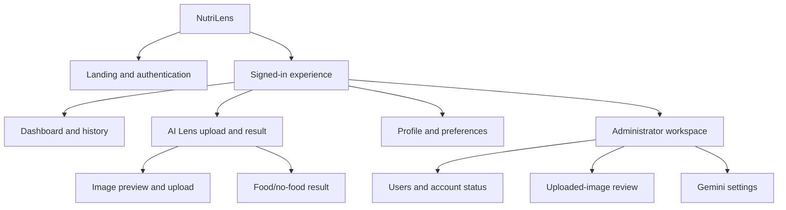

# NutriLens Product Design Reference

This document describes the implemented NutriLens experience. Original visual assets in `designs/assets/` remain useful as design references, but they do not define the current API, storage, or AI implementation.

## Product principles

| Principle | Applied design decision |
|---|---|
| Clear expectations | Results are labelled as visible-portion estimates and not medical advice. |
| Guided first scan | The profile requires a display name, age, height, and weight before a new upload. |
| Plain language | Benefits, cautions, suggestions, and the summary avoid unnecessary nutrition jargon. |
| Useful uncertainty | The UI shows a dedicated no-food state rather than inventing a food result. |
| Private by default | Users view only their own images/history; administrator review is role-protected. |
| Mobile-first | Core navigation and actions remain usable on a narrow screen. |

## Information architecture

## Primary user flow

1. A visitor opens the landing screen and signs in or registers.
2. The app restores the session and loads the profile plus history.
3. A new user completes required profile fields before scanning.
4. On AI Lens, the user selects a JPG, PNG, or WebP food photo and confirms upload.
5. The app displays loading progress, then either a no-food state, an actionable error, or the model result.
6. A food result shows the estimate, classification, recommendation, benefits, cautions, and suggestions. Users can return to Dashboard or start another scan.
7. A user can update profile details and review historical results; an administrator can access protected operational tools.

## Screen specifications

| Screen | Purpose | Essential content/states |
|---|---|---|
| Landing | Explain the app and prompt entry. | Product message, sign-in, registration. |
| Login/registration | Establish an authenticated session. | Labeled fields, validation, loading, error feedback. |
| Dashboard | Review activity. | Recent scans, history selection, calendar-oriented pattern view, empty state. |
| AI Lens | Create a scan. | File selection/preview, profile-gate notice, upload/analyzing states, retryable errors. |
| Result | Explain one analysis. | Food name or no-food indicator, confidence, estimate, classification, recommendation, guidance. |
| Profile | Keep context accurate. | Name, email, age, gender, height, weight, goal, health conditions, allergies, save/sign-out. |
| Admin | Operate the service. | Overview, users, uploaded images, logs, model/key-pool configuration. |

## Result and error language

- Use **estimate** or **visible portion** for calculated values; avoid treating results as measured facts.
- Present classifications and recommendations as guidance, never diagnoses.
- For unclear/non-food images, use “No food detected” and invite a clearer meal image.
- Give upload and service errors a useful next action without exposing keys, stack traces, or internal system details.
- Direct allergy matches receive an explicit warning and `Avoid` recommendation, while reminding users that image recognition cannot guarantee hidden ingredients.

## Visual system

The interface uses a calm green health-oriented palette, light card surfaces, strong dark-text contrast, and amber/rose states for moderation/warnings. Buttons, fields, tabs, status labels, and images have visible keyboard focus states. Color is paired with text for classifications and error status.

The application uses responsive single-column behavior for primary mobile flows and expands dashboard/admin grids at larger breakpoints. Images have descriptive alt text and fields have labels; administrators use tab semantics for their workspace sections.

## Implementation alignment

The UI calls a session-cookie API at `VITE_API_BASE_URL`, uploads before analysis, and never handles Gemini credentials. Gemini runs only behind the backend after request validation. See [../documentation/system_design_document.md](../documentation/system_design_document.md) and [../documentation/api_design.md](../documentation/api_design.md) for the supporting technical design.
