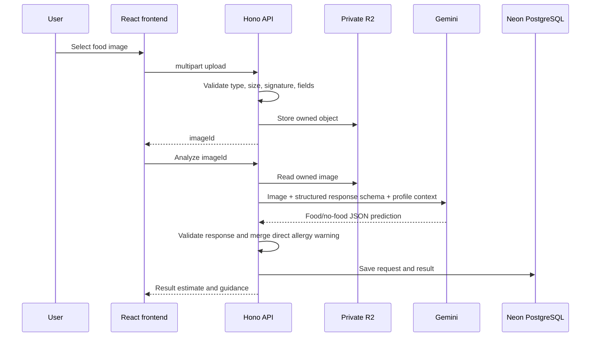
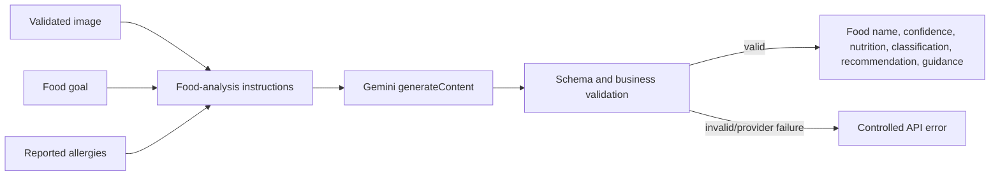

# Gemini Analysis Workflow

NutriLens does not run YOLO, EfficientNet, ShuffleNet, or a local Food-101 classifier. Gemini receives the validated uploaded image from the backend and is required to produce a schema-constrained JSON response.

## Gemini response shape

For images that do not clearly show food, the requested response sets `isFood` to false, labels the item `Not food`, provides zero nutrition values, and omits health guidance.
