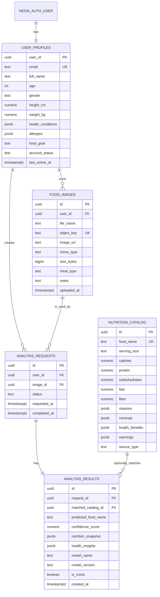

# ER Diagram

The `NEON_AUTH_USER` entity is managed by Neon Auth and is shown only to explain the profile association. R2 object bytes are intentionally outside this relational diagram; `food_images.object_key` links an image record to its private object.
