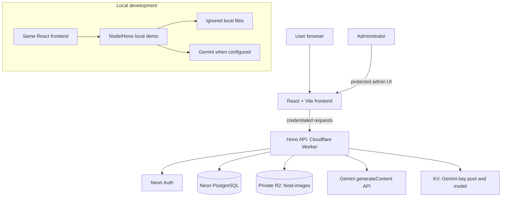

# System Architecture Diagram

## Runtime responsibilities

- The frontend handles interaction, session restoration, upload selection, and result presentation.
- The Worker is the public trust boundary: it proxies auth, validates requests, scopes data to the user, and controls AI/image access.
- Neon holds relational profile, metadata, request, result, and system-event data.
- R2 holds image bytes privately; the API owns access checks.
- Gemini receives a server-side image request and returns structured analysis JSON.
- KV stores administrator-managed keys/model; a Worker secret can provide a fallback key.
