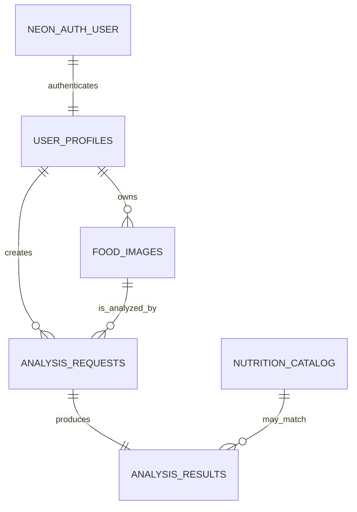

# Database Design

Production application data is stored in Neon PostgreSQL. Authentication-managed tables are owned by Neon Auth in the `neon_auth` schema; application migrations do not alter them. Image bytes live in the private `food-images` R2 bucket, while PostgreSQL stores metadata and result history.

## Application tables

| Table | Purpose |
|---|---|
| `user_profiles` | One application profile per authenticated user, including account status and food preferences. |
| `food_images` | Owned upload metadata and R2 object key. |
| `nutrition_catalog` | Manually maintained starter food data used by lookup endpoints and optional result matching. |
| `analysis_requests` | Each stored food-analysis request. |
| `analysis_results` | One validated Gemini result per analysis request. |
| `system_events` | Recent operational events for the administrator overview. |
| `schema_migrations` | Migration runner bookkeeping. |

## Key fields

### `user_profiles`

`user_id` is the primary key and corresponds to the authenticated user. The table contains `email`, `full_name`, `age`, `gender`, `height_cm`, `weight_kg`, `health_conditions`, `allergies`, `food_goal`, `account_status`, `last_active_at`, `created_at`, and `updated_at`. `food_goal` defaults to `Eat balanced`; supported values in the API are `Lose weight`, `Gain weight`, and `Eat balanced`.

### `food_images`

Each image has UUID `id`, `user_id`, original `file_name`, unique R2 `object_key`, optional `image_url`, `mime_type`, `size_bytes`, optional `meal_type`/`notes`, and `uploaded_at`. The object key, not a public URL, is the authoritative storage reference.

### Analysis and catalog tables

`analysis_requests` links a user and image and records `status`, `requested_at`, and `completed_at`. `analysis_results` is one-to-one with a request and includes optional `matched_catalog_id`, predicted food, confidence, JSON nutrition snapshot, JSON health insights, model metadata, `is_mock`, and creation time. The live Worker persists Gemini results with `is_mock = false`.

`nutrition_catalog` contains a manually seeded starter catalog: food identity, serving size, macro/fiber values, vitamins/minerals, health benefits/warnings, source type, and timestamps. It is not represented as a medical or authoritative nutrition database.

## Relationships

## Integrity and performance

- UUID primary keys use `pgcrypto`’s `gen_random_uuid()` where applicable.
- Foreign keys cascade when a profile, image, or request is removed; a catalog match is set to null if that catalog row is removed.
- Unique constraints protect profile email, image object key, catalog food name, and result-per-request.
- `set_updated_at` triggers update timestamps for profiles and catalog rows.
- Indexes support scans by user and time, plus recent system-event retrieval.

The source of truth is the migrations in [`../backend/migrations`](../backend/migrations), applied in numeric order with `pnpm run db:migrate`.
