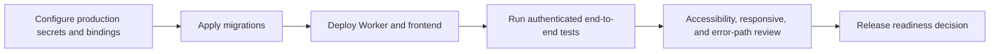

# NutriLens Development Roadmap

This roadmap reflects the codebase as it exists today rather than the earlier plan to train a Food-101 model or use a third-party nutrition API. Gemini is the implemented food-analysis provider.

## Delivery status

| Workstream | Status | Delivered scope |
|---|---|---|
| Foundation | Complete | pnpm workspace, React/Vite frontend, Hono Worker, local demo launcher. |
| Identity and profiles | Complete | Neon Auth proxy, sessions, profile validation, food goal/allergies, account status. |
| Images and persistence | Complete | R2 upload/image access, Neon migrations, history, catalog lookup. |
| AI analysis | Complete | Server-side Gemini call, key rotation, schema validation, no-food response, goal/allergy-aware guidance. |
| Administrator tools | Complete | User/scan overview, upload review, account suspension, AI-settings management. |
| Quality gates | In progress | Static type checks exist; automated and end-to-end tests still need implementation. |
| Production release | In progress | Requires project-specific Worker secrets, bindings, migration execution, and acceptance testing. |

## Remaining release work

## Release checklist

- [ ] Create and verify production Neon database, Neon Auth endpoint, R2 bucket, KV namespace, and rate-limit bindings.
- [ ] Set `DATABASE_URL` and `NEON_AUTH_URL` Worker secrets; configure a Gemini fallback or an admin key pool.
- [ ] Confirm the configured frontend origin is included in `ALLOWED_ORIGINS`.
- [ ] Run `pnpm run db:migrate`, `pnpm run typecheck`, and `pnpm run build:frontend`.
- [ ] Verify sign-up/sign-in, profile gate, upload, no-food behavior, food result, history, and owner-only image access.
- [ ] Verify administrator access and a non-admin denial.
- [ ] Exercise provider-error, quota, invalid upload, and suspended-account behavior.
- [ ] Document production URLs and deployment owner before final release.

## Future improvements

- Add automated unit, integration, and browser tests.
- Add structured monitoring/alerting and production performance measurements.
- Evaluate nutrition data quality with curated sources and provenance.
- Improve multi-item meal handling and user feedback for incorrect predictions.
- Add user-controlled record/image deletion and data-retention policy documentation.
