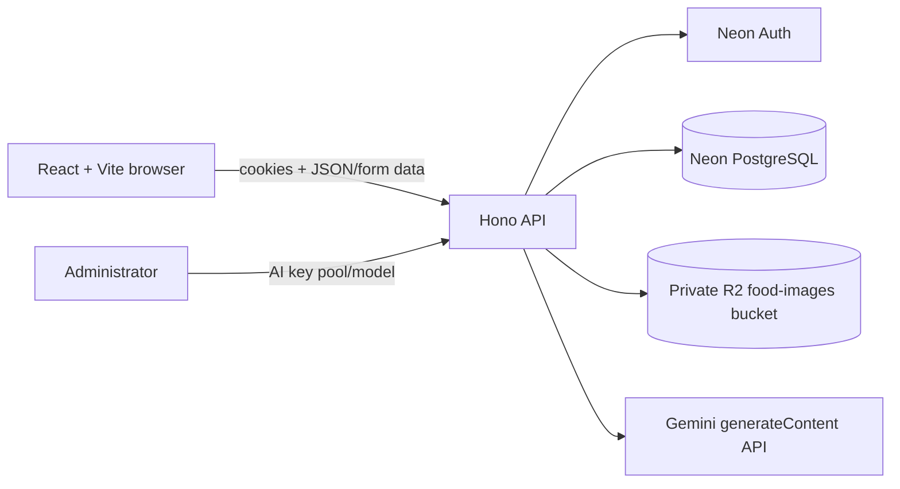

# System Design Document

## 1. System context

NutriLens is a single-page React application backed by a Hono API. Production runs the API on Cloudflare Workers, uses Neon Auth and Neon PostgreSQL, keeps images in a private Cloudflare R2 bucket, and asks Gemini to analyze a stored upload. The local development mode replaces Cloudflare, Neon, and R2 with a Node/Hono server, local files, and in-memory records.

## 2. Main workflow

1. The frontend signs users in through the Worker’s `/api/auth/*` proxy.
2. A protected route resolves the session with Neon Auth, ensures the profile exists, verifies active account status, and applies the API rate limit.
3. The user completes display name, age, height, and weight. Until then, uploads are rejected.
4. The upload route validates the image type, bytes, file signature, optional meal type, and notes; it writes the object to R2 and metadata to PostgreSQL.
5. The analysis route reads the owned object, chooses a configured Gemini key/model, requests structured output, and validates the reply.
6. A successful result is stored with the analysis request and returned to the user. The frontend can retrieve it later from history.

## 3. Analysis result

Gemini returns whether the image is food, a primary food name, confidence, visible-portion nutrition estimate, classification (`Healthy`, `Moderate`, or `Unhealthy`), recommendation (`Eat`, `Limit`, or `Avoid`), benefits, cautions, suggestions, and a short explanation. The backend augments direct matches to the user’s reported allergies and forces an `Avoid` recommendation where appropriate.

If the image does not clearly show food, Gemini is asked to return `isFood: false`, `foodName: "Not food"`, zero nutrition values, and no nutrition guidance. The UI represents this as **No food detected**.

## 4. Security design

- Authentication routes proxy Neon Auth; application code does not persist passwords.
- Cookies are forwarded and normalized by the Worker. Protected routes require the active session.
- Origins are allowlisted and credentialed; auth and protected endpoints have separate Worker rate limits.
- R2 objects are private by default. A user can read only their own image; administrators use separate protected review routes.
- User-provided identifiers, profile fields, metadata, image content, Gemini settings, and Gemini responses are validated before use.
- API keys live only in Worker secrets or `GEMINI_SETTINGS_KV`; they are never sent to the browser.
- Unexpected failures receive a generic response with a request ID; detailed diagnostics are logged server-side.

## 5. Operational configuration

`DATABASE_URL` and `NEON_AUTH_URL` are Worker secrets. `FOOD_IMAGES`, `GEMINI_SETTINGS_KV`, `AUTH_RATE_LIMIT`, and `API_RATE_LIMIT` are Worker bindings. `GEMINI_API_KEY` is an optional fallback, and the administrator-managed key pool takes precedence when set. See [../README.md](../README.md) for deployment commands.

## 6. Local development differences

The local demo server supplies compatible frontend-facing routes. It stores uploads and AI settings in ignored `.local-storage/` paths and resets profile/history/account data when the process stops. It uses Gemini only after a server-side key is configured. Local mode is not a production security or persistence substitute.
